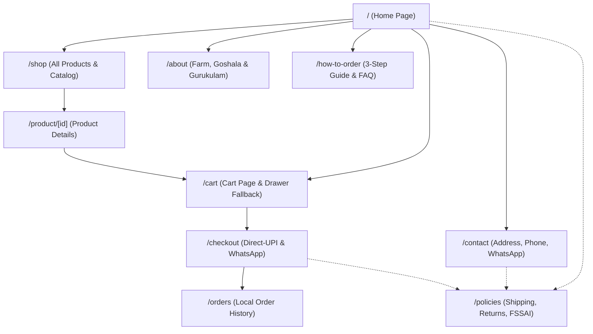

# Phase 0: Information Architecture & Sitemap

**Project:** Kurmagram Vedic Village (కూర్మగ్రామ వేదిక్ విలేజ్)  
**Document Status:** Pending User Review & Approval  
**Architecture:** Static Multi-Page Astro Site (Zero-JS default with interactive islands)

---

## 1. Visual Site Map Diagram

---

## 2. Detailed Route Inventory

| Route | Page Title (Telugu / English) | Primary Purpose & Section Breakdown | Interactive Islands |
|---|---|---|---|
| **`/`** | కూర్మగ్రామ వేదిక్ విలేజ్ / Kurmagram Vedic Village | **Storefront Entrance & Brand Anchor:** • Asymmetric golden-hour farm hero with vertical Telugu display headline & Kurma mark. • Featured harvest spotlight (Brown rice offer & wood-churned oils). • Pinned "Soil-to-Bottle" scrollytelling teaser (60 acres / 2018 / 80 residents). • Sacred Goshala & Natural Farming trust pillars. • 3-Step visual order guide preview. • Handloom footer with address, phone numbers, and Kolam grid. | `CartDrawerToggle`, `LanguageSwitcher`, `AudioChimeToggle` |
| **`/shop`** | ఉత్పత్తుల భాండాగారం / Village Catalog | **Complete Store Catalog:** • Fuse-powered fuzzy instant search (Telugu + English keys). • Natural-dye swatch category chips (`All`, `Care`, `Cow`, `Farm`, `Grain`, `Oils`). • Price & popularity sorting. • Kraft-paper product cards with custom 2px Kalamkari line art, brass price tab, and unit picker. • Quick "కార్ట్లో చేర్చు" (Add to Cart) action. | `CatalogFilterIsland`, `CartDrawerIsland` |
| **`/product/[id]`** | [ఉత్పత్తి పేరు] / [Product Name] | **Editorial Product Profile:** • High-resolution natural farm / preparation photography gallery. • Detailed traditional preparation narrative & Vedic medicinal rationale. • Packaging variant selection (e.g. 500ml vs 1L, 1kg vs 25kg bulk with discount tag). • Real-time stock status & FSSAI statutory declaration. • Direct-UPI 0% fee assurance badge & WhatsApp fast inquiry link. • Related village preparations from the same category. | `VariantSelectorIsland`, `AddToCartIsland`, `FastWhatsAppInquiry` |
| **`/about`** | మా గ్రామం & జీవన విధానం / About Kurmagram | **Cultural & Farm Heritage:** • The 60-acre community chronicle (Est. 2018, Srikakulam District). • Nanda Gokulam Goshala: Indigenous desi cow protection & ahimsa philosophy. • Vedic Gurukulam & traditional living practices. • Zero-chemical natural farming methodology (Jeevamrutham, Neemastra, Ghanajeevamrutham). • Photo gallery from www.kurmagram.com. | Static (Zero-JS) |
| **`/how-to-order`** | ఆర్డర్ చేయడం ఎలా / How to Order | **Transparent Ordering & UPI Guide:** • Step 1: Select pure natural preparations. • Step 2: Pay directly using any UPI app (GPay / PhonePe / Paytm / BHIM) with zero transaction fee. • Step 3: Enter your transaction reference (UTR) and verify via one-tap WhatsApp. • Interactive UPI QR walkthrough & FAQ for first-time buyers. | `UpiSimulatorPill` |
| **`/contact`** | సంప్రదించండి / Contact Us | **Direct Direct-Farmer Channel:** • Physical address: Near Anthakapalli Village, Kittalapadu Post, Via Shrimukhalingam, Srikakulam - 532428. • Direct phone links: `+91-7732075607`, `+91-8712011776`. • One-tap WhatsApp chat launcher. • Interactive accessibility transport & pilgrimage route directions. | `OneTapWhatsAppButton` |
| **`/cart`** | మీ సంచి / Your Cart | **Cart Overview & Fallback:** • Full-page fallback for the interactive cart slide-over drawer. • Itemized review of preparations, selected quantities, and weight tiers. • Free shipping eligibility calculation. • Clear order total calculation with ₹0 payment processing fee disclosure. | `CartManagerIsland` |
| **`/checkout`** | ఆర్డర్ వివరాలు & చెల్లింపు / Checkout & UPI Payment | **Direct-UPI Checkout Engine:** • Customer delivery details form (Name, WhatsApp Phone, Village/Town, Postal Code). • Live NPCI-compliant `upi://pay` deep link button for mobile devices. • In-browser generated UPI QR code (Error correction Level M) for desktop scan. • 12-digit UTR (UPI transaction reference) input & verification. • One-tap WhatsApp receipt generator with pre-formatted Telugu/English order dispatch. • Synthesized temple-bell celebration chime & saffron/green confetti burst. | `CheckoutFlowIsland` (Direct-UPI + UTR + WhatsApp handoff) |
| **`/orders`** | మీ గత ఆర్డర్లు / Order History | **Offline-First Order History:** • Client-side order repository stored in `localStorage` (`kurmagram_orders_v1`). • Order cards showing Order ID (`KG-YYYYMMDD-XXXX`), status, and timestamp. • Instant "మళ్ళీ ఆర్డర్ చేయండి" (One-Click Reorder) button. • WhatsApp tracking lookup link. | `OrderHistoryIsland` |
| **`/policies`** | నిబంధనలు & విధానాలు / Policies | **Trust & Statutory Governance:** • Safe eco-friendly packaging & dispatch policy across Andhra Pradesh & India. • Traditional farm returns & transit damage replacement guarantee. • Customer privacy (zero trackers, zero ad pixels, zero selling of personal data). • FSSAI statutory declaration & Nanda Gokulam Goshala Trust certification. | Static (Zero-JS) |

---

## 3. Technical & SEO Endpoints

- **`/sitemap.xml`**: Automatically generated XML sitemap indexing all canonical routes and product detail pages.
- **`/robots.txt`**: Search engine spider instructions permitting crawling of public storefront routes.
- **`/manifest.json`**: PWA manifest featuring official Kurmagram logo icons, theme color (`#2f6b3a`), and offline capabilities.
- **`/sw.js`**: Service Worker providing offline caching for static assets, vendored fonts, and catalog data.

---

## 4. Key IA Design Decisions

1. **Dual Cart Experience:** An accessible slide-out drawer on all pages for quick operations, accompanied by a dedicated `/cart` route for keyboard navigation and no-JS graceful degradation.
2. **Zero-Friction Checkout:** Direct-UPI eliminating 3rd-party gateway redirects. Customer stays on the domain, scans QR or taps deep link, enters UTR, and transitions smoothly to WhatsApp.
3. **No Dead Ends:** Every content page contains an intentional path to the product catalog and a direct WhatsApp consultation trigger.
