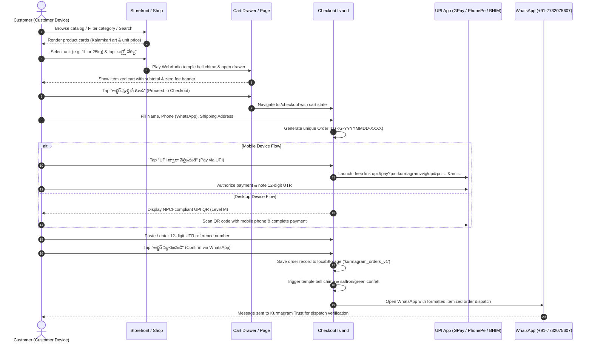
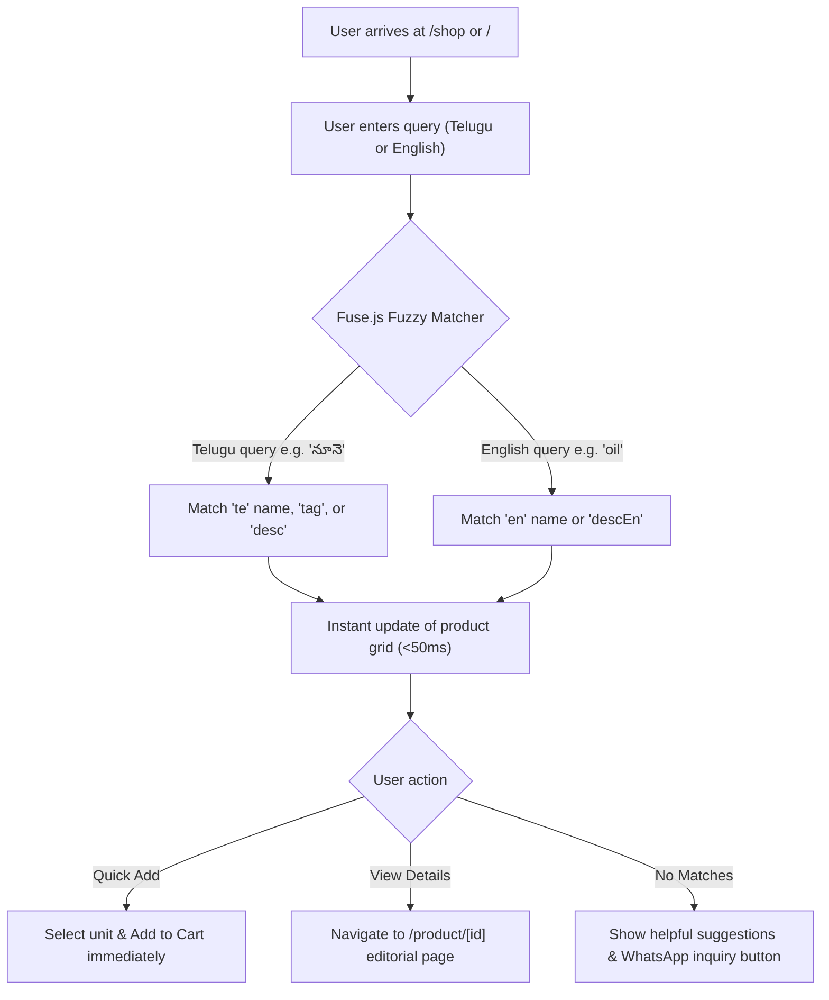
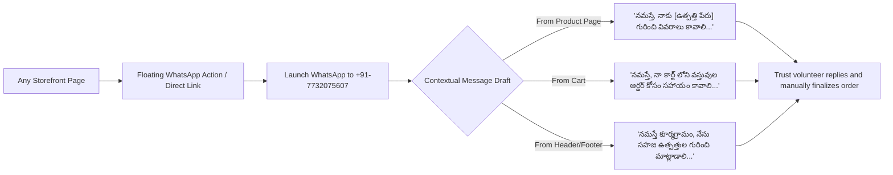
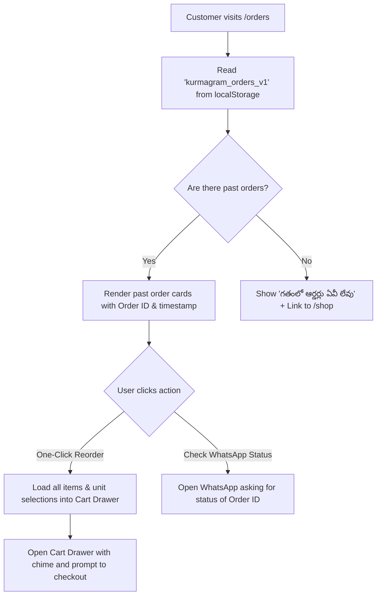

# Phase 0: User Journeys & Interaction Flows

**Project:** Kurmagram Vedic Village (కూర్మగ్రామ వేదిక్ విలేజ్)  
**Document Status:** Pending User Review & Approval  
**Payment Architecture:** 100% Free Peer-to-Peer UPI (`upi://pay`) + UTR Manual Verification + WhatsApp Dispatch

---

## Flow 1: Primary Purchase Flow (End-to-End)

---

## Flow 2: Instant Search & Discovery Flow

---

## Flow 3: WhatsApp Fallback at Any Stage

Kurmagram is a community-first trust store. If a customer is uncomfortable with forms, lacks a UPI app, or has custom delivery questions, a direct human channel is always accessible:

---

## Flow 4: Order History & 1-Click Reorder Flow

---

## Flow 5: Graceful Degradation & No-JS Fallback Path

When a user browses with JavaScript disabled or on an ultra-low-bandwidth network:

1. **Static Catalog Display:** Product titles, full descriptions, unit pricing tables, and FSSAI notices render purely in HTML/CSS without relying on client-side JS.
2. **Accessible Direct Links:** Every product has a direct WhatsApp link encoding product name and selected unit:
   `https://wa.me/917732075607?text=నమస్తే,%20నేను%20[ఉత్పత్తి]%20ఆర్డర్%20చేయాలనుకుంటున్నాను`
3. **Static Fallback Route `/cart` & `/how-to-order`:** Full static page explains the 3-step UPI process, provides the direct UPI ID (`kurmagramvv@upi`), and presents phone numbers (`+91-7732075607`, `+91-8712011776`).
4. **Visible Content Guarantee:** No entrance animations keep content opacity at `0`. All CSS animations are progressive enhancements activated only under `.js` classes.
